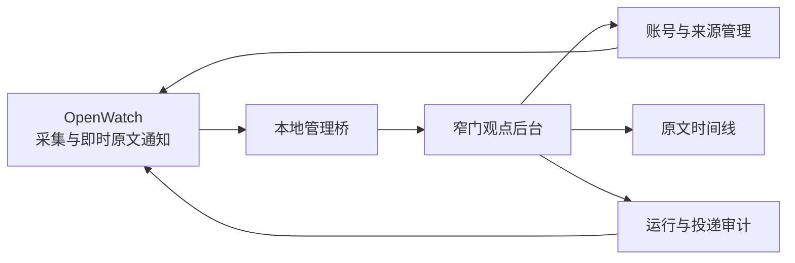

# 窄门观点中心设计

窄门的第一期只交付“观点”模块：把已经运行的 OpenWatch 变成可管理、可回看、可审计的观点中枢。它服务于个人 A 股研究，不替代交易决策；复盘、计划、持仓、战法和 AI 观点卡均不在本期实现范围内。

## 已确认的决策

- OpenWatch 是观点采集和即时通知的唯一执行者；窄门不重复爬取、不直接向 Bark 发送内容。
- 新内容采集成功后立即按推送路由发送原文，不等待 AI。AI 观点卡、主题聚合、个股和题材归因后置。
- 当前全局通知渠道是 Bark。未来实际投递渠道等于“全局已启用渠道”与“该博主额外配置渠道”的并集；博主额外渠道不会覆盖全局渠道。
- 首期只呈现原始内容与来源元数据。所有来源保留各自的正文、发布时间、图片和原文链接，不强制统一成同一篇“文章”格式。
- 模糊的个股、题材或市场关联不在本期自动归类。

## 用户完成的工作

在“观点”后台，用户可以：

1. 查看所有来源和博主的启用状态、采集频率、最近成功采集时间与错误状态；
2. 启用、停用博主或来源，调整可配置的采集频率；
3. 按来源、博主、内容类型和时间浏览历史原文；
4. 查看内容是否已记录、是否已投递，以及失败时的原因；
5. 查看全局 Bark 配置的启用状态，并为博主添加未来支持渠道的额外路由。

## 数据与职责边界

OpenWatch 当前以本地 SQLite 数据库 `ths_monitor.db` 保存不同来源的账号与内容，且已有全局 `notification_channels` 配置和来源启动控制。窄门不能把该数据库当成任意可写的共享表：采集进度、去重和内容投递仍由 OpenWatch 所有。

首期新增一个仅绑定本机的 OpenWatch 管理桥。它向窄门提供已规范化的来源、博主、内容与健康状态；所有变更都通过桥调用 OpenWatch 自己的账户或来源控制逻辑。桥不返回 Bark 密钥、Cookie、令牌或浏览器会话。窄门保存自己的浏览偏好、筛选条件和管理操作审计，不复制敏感配置。

内容的通用展示记录至少包含来源、博主、来源内唯一标识、内容类型、发布时间、采集时间、正文、图片引用、原文链接和 OpenWatch 的投递状态。来源专属字段保留在只读原始载荷中，窄门不会把不同来源的内容语义混为一谈。

## 通知路由

全局渠道是基础路由。博主可以追加零个或多个渠道，实际投递集合按去重后的并集计算。首期现有执行器只有 Bark，因此后台会完整显示全局 Bark 状态；额外渠道的数据模型和管理入口可存在，但未注册执行器的渠道必须显示为“未配置”，不能伪装成已投递。

每次投递都按“内容、渠道”记录结果。历史 OpenWatch 记录若只有内容层面的 `sent` 状态，后台必须标明“历史渠道明细未知”，不能推断为 Bark 成功。

## 与 Vibe-Astock、a-stock-data 的关系

Vibe-Astock 是后续本地市场研究与模型能力引擎，a-stock-data 是其可调用的数据 Skill；两者不参与本期的内容采集或通知执行。后续 AI 分析只读取已经入库的原文证据，并把模型输出单独存为可重跑、可追溯的派生记录，绝不覆盖原文。

## 本期验收

- 现有 OpenWatch 已启用账号和历史内容能在窄门按来源正确显示；来源专属字段不串台。
- 从窄门发起的启停操作实际影响 OpenWatch，且不删除账号或历史内容。
- 内容时间线中的原文链接不成为默认通知跳转；窄门仅展示链接。
- 全局 Bark 的当前状态可见；新增的博主额外路由不会移除全局 Bark。
- 管理桥只监听本机，且任何响应、日志和页面都不含密钥、Cookie、令牌或配对码。
